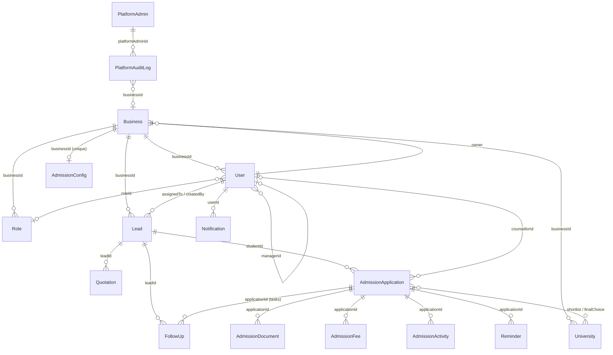

# FlowOne CRM — Current System Analysis (handover)

Analysis date: 2026-11-05. Branch analysed: `feature/syb-admissions` (local working tree equals `origin/feature/syb-admissions`, latest commit `a2cd479`).
Method: read-only inspection of source, schemas (introspected without a database connection), routes, tests and git history. Nothing in the application or database was changed to produce this document.

> **Naming.** The owner calls the product "FlowOne CRM". In the code and UI it is branded **Kelto** (logo `sales-follow-up-web/public/kelto-mark.svg`, page titles "… | Kelto"). Repository folders are `sales-follow-up-backend` and `sales-follow-up-web`; the API health message says "Sales Follow-up API"; the default mail sender is "Sales Follow-up OS". All of these refer to the same application.

Legend used throughout: **Implemented** (works end to end, backed by API and tests), **Partial**, **UI-only / placeholder**, **Not implemented**, **Cannot verify** (depends on deployment settings or data not visible in the repo).

---

## 1. Executive summary

- A multi-tenant **sales follow-up CRM** (leads, follow-ups, sales pipeline, quotations, reports, team, custom roles) with an optional **Admissions** module for study-abroad agencies (student journey through configurable stages, checklists, documents, fees and payments, interviews/exams, visa outcome, reminders).
- **Tenancy:** one MongoDB database; every tenant record carries `businessId` (the tenant is the `Business` model, called a "workspace" in the UI). Isolation is enforced in application code by filtering on `req.user.businessId`. There is no database-level isolation.
- **Auth:** email/password and Google sign-in, JWT bearer tokens (default expiry 1 day), self-service organisation registration.
- **Permissions:** a central catalog of 40 `module.action` permissions plus per-module data scopes (own/team/all), stored in a per-tenant `Role` collection. Roles are fully customisable by the workspace owner. Every API route checks permissions; the frontend hides buttons with a `*ktCan` directive.
- **Modules:** exactly one module can be switched on/off per tenant — **Admissions** (`Business.features.admissions`). Everything else is always on.
- **Super Admin:** a first version exists (added 2026-11-05). It has a separate `PlatformAdmin` account type, a `/platform` console (workspaces, people, audit log, Admissions on/off) and a read-only, one-hour "view as workspace" mode.
- **Not present:** subscription plans, SaaS billing, accounting/finance, HR/payroll, custom fields, a customers/accounts entity (stub only), lead import/export, quotation PDF/email.
- **Stack:** Node.js + Express 5 + Mongoose 9 (MongoDB Atlas) API; Angular 22 standalone/zoneless SPA. Live hosting according to environment files: API on Render (`https://sales-os-mw2s.onrender.com/api`), web on Vercel (`https://sales-os-web-1.vercel.app`).

---

## 2. Technology stack

| Layer | Technology (from package.json) |
|---|---|
| Backend runtime | Node.js, CommonJS modules |
| Web framework | express 5.2, cors, multer 2 (uploads) |
| Database / ODM | MongoDB (Atlas cluster in `.env`), mongoose 9.11 |
| Auth | jsonwebtoken 9, bcryptjs 3, google-auth-library 11 (Google ID-token verification) |
| Files | @aws-sdk/client-s3 + s3-request-presigner (S3/R2 driver), local filesystem driver |
| Exports | exceljs 4 (XLSX), hand-written CSV |
| Mail | nodemailer 10 (SMTP only) |
| Backend tests | node:test, supertest, mongodb-memory-server (in-memory MongoDB) |
| Frontend | Angular 22.1 (standalone components, signals, new control flow, functional guards/interceptors, no zone.js), rxjs 7.8, ngx-sonner (toasts) |
| Frontend tests | vitest 4 + jsdom (`ng test`) |
| Styling | Hand-written SCSS with design tokens (`src/styles/kelto-colors.css`); no UI component library |
| Hosting | Render (API) and Vercel (web), configured in their dashboards (no `render.yaml` / `vercel.json` in the repo) |

Environment variable **names** used by the backend (values are not recorded here):
`MONGO_URI, JWT_SECRET, JWT_EXPIRES_IN, PORT, NODE_ENV, APP_URL, CLIENT_URL, GOOGLE_CLIENT_ID, SMTP_HOST, SMTP_PORT, SMTP_USER, SMTP_PASS, MAIL_FROM, MAIL_TRANSPORT, STORAGE_DRIVER, STORAGE_LOCAL_DIR, S3_ENDPOINT, S3_REGION, S3_BUCKET, S3_ACCESS_KEY_ID, S3_SECRET_ACCESS_KEY, S3_FORCE_PATH_STYLE, UPLOAD_MAX_MB, ADMISSIONS_JOB_INTERVAL_SECONDS, PLATFORM_LOGIN_MAX`.
Frontend environment (`sales-follow-up-web/src/environments/`): `apiUrl`, `googleClientId`, `production`. `environment.ts` (production) points to the Render API; both development frontends point to `http://localhost:5001/api`, the normal API backed by `MONGO_URI`. The optional in-memory demo can also be started on port 5001 when the normal API is stopped.

---

## 3. Project architecture

### 3.1 Repository layout

```
CRM/
├─ sales-follow-up-backend/
│  ├─ ADMISSIONS.md                 operations guide for the admissions module (env vars, R2 setup, jobs)
│  ├─ scripts/
│  │  ├─ seed.js                    seeds the "SYB Education" business, team, universities (real DB in MONGO_URI)
│  │  ├─ admissions-enable.js       turns admissions on for one owner's business + default config
│  │  ├─ create-super-admin.js      ONLY way to create/reset/deactivate/list platform super admins
│  │  └─ dev-memory.js              in-memory demo API (synthetic data, demo logins, demo super admin)
│  ├─ src/
│  │  ├─ server.js                  connect DB → run migrations → start jobs → listen
│  │  ├─ app.js                     express app: CORS, JSON, routes, 404, error handler
│  │  ├─ config/db.js               connectDB
│  │  ├─ middleware/                authMiddleware.js, platformAuth.js
│  │  ├─ routes/                    12 routers (see §7)
│  │  ├─ controllers/               one per area; admissions/ has 11 controllers
│  │  ├─ models/                    17 Mongoose models (see §8)
│  │  ├─ services/
│  │  │  ├─ access/                 catalog.js (permissions, default roles), index.js (loadAccess, scopes)
│  │  │  ├─ admissions/             workflow engine, fees, reminders, exports, filters…
│  │  │  ├─ platform/               super admin tokens, read-only view user, audit, rate limiter
│  │  │  ├─ storage/                local/S3 drivers, upload validation, signed file links
│  │  │  ├─ authService.js          generateToken
│  │  │  └─ mailer.js               sendMail (SMTP or in-memory outbox)
│  │  ├─ jobs/                      quotationExpiryJob.js, admissionsReminderJob.js (setInterval in API process)
│  │  ├─ migrations/                001-lead-phone-digits, 002-default-roles, 003-fee-list, index.js runner
│  │  └─ seed/seedSyb.js
│  └─ test/                         21 test files, ~166 tests, helpers.js
├─ sales-follow-up-web/
│  ├─ public/kelto-mark.svg
│  └─ src/
│     ├─ app/app.routes.ts, app.config.ts
│     ├─ app/core/                  guards/, interceptors/, services/ (13 services), utils/
│     ├─ app/dashboard/             app shell (sidebar, mobile nav) + home dashboard
│     ├─ app/leads, follow-ups, pipeline, quotations, reports, team, settings (+ settings/roles)
│     ├─ app/admissions/            module: layout, overview, pipeline-board, students, student-profile/*, assessments, my-tasks, payment-tracker, settings, shared/
│     ├─ app/platform/              super admin console
│     ├─ app/auth/                  login, register, forgot/reset password
│     ├─ app/shared/                can directive, notification bell, pager, platform-view banner
│     ├─ app/customers/             unused generated stub
│     └─ styles/                    _data-table.scss, _pipeline-board.scss, admissions.scss, kelto-colors.css, kelto-select.scss
└─ docs/
   ├─ superpowers/specs, plans      admissions design/requirements and implementation plans (2026-11-03)
   └─ client-user-guide/            screenshots for a user guide (no rendered guide in output/)
```

### 3.2 How the parts communicate

- The SPA calls the REST API at `environment.apiUrl` (`/api/...`) with `Authorization: Bearer <JWT>` added by `core/interceptors/auth.interceptor.ts`. Super admin calls to `/api/platform/*` use a separate console token.
- Response envelope (not fully uniform): `{ success, message?, code?, data }`. Some list endpoints put `pagination` inside `data` (leads: `data.leads`, `data.pagination`); follow-ups and quotations return `data` as an array with `pagination` beside it; admissions lists use `data.items` / `data.total`.
- Files: uploads are multipart (`multer` memory storage) → validated → stored through the storage driver → downloaded through 60-second signed links (`GET /api/admissions/files/:token`, `services/storage/uploads.js#issueFileLink`).
- Background work runs inside the API process: `startQuotationExpiryJob` (every 30 min) and `startAdmissionsReminderJob` (every `ADMISSIONS_JOB_INTERVAL_SECONDS`, default 60 s).
- Migrations run automatically at every API start (`src/migrations/index.js#runMigrations`). Applied ids are stored in the `migrations` collection.

---

## 4. Complete module inventory

| Module | Purpose | Status | Can it be switched off per tenant? |
|---|---|---|---|
| Authentication & registration | Sign up an organisation, sign in, Google, password reset | Implemented (Google: Cannot verify live config) | No |
| Home dashboard | Today's follow-ups, pipeline totals, conversion | Implemented | No |
| Leads | Prospect records | Implemented (import/export are placeholders) | No |
| Follow-ups | Scheduled tasks/calls against leads | Implemented | No |
| Sales pipeline | Kanban of lead statuses | Implemented | No |
| Quotations | Itemised quotes linked to leads | Implemented (no PDF/print/email) | No |
| Reports | Sales analytics computed in the browser, CSV export | Implemented (client-side) | No |
| Team | Users of a workspace, manager hierarchy | Implemented | No |
| Roles & permissions | Custom roles, permissions, data scopes | Implemented | No |
| Settings | Profile, password, business details, currency, logo | Implemented | No |
| Notifications | In-app bell | Implemented (only admissions produces notifications) | No |
| Admissions | Student journey, documents, fees, visa | Implemented | **Yes** (`Business.features.admissions`) |
| Platform super admin | Cross-tenant console, read-only workspace view, audit | Implemented (first version) | n/a |
| Customers | — | **Placeholder** (`app/customers/customers.ts` renders "customers works!", not routed) | — |

---

## 5. Existing features per module

### 5.1 Authentication & organisation registration
- **Files:** `controllers/authController.js` (`register, login, googleAuth, forgotPassword, resetPassword, getMe`), `services/authService.js#generateToken`, `middleware/authMiddleware.js`, frontend `auth/*`, `core/services/auth.service.ts`, `core/services/google-auth.service.ts`.
- **Register** (`POST /api/auth/register`): creates a `Business` plus an owner `User` (`role: 'OWNER'`), creates the built-in roles (`ensureDefaultRoles`), and returns a JWT. Self-service with no approval. Admissions is off by default.
- **Login:** email + password (bcrypt). Rejected if the user or business is inactive (`isActive`).
- **Google:** `POST /api/auth/google` verifies a Google ID token. An unknown Google user gets `GOOGLE_SIGNUP_REQUIRED` and can register a business. *Cannot verify* that it works live: `googleClientId` is empty in both frontend environment files, and the backend needs `GOOGLE_CLIENT_ID`.
- **Password reset:** token emailed with link `APP_URL/auth/reset-password?token=…`. Mail is only sent when `SMTP_HOST` is set; otherwise it goes to an in-memory `outbox` and is **not delivered** (`services/mailer.js`). *Cannot verify* the live SMTP setup.
- **JWT claims:** `{ userId, businessId, role }`, signed with `JWT_SECRET`, expiry `JWT_EXPIRES_IN` (default `1d`). Permissions are **not** trusted from the token: `authMiddleware` reloads them via `loadAccess` (15-second in-memory cache), so role changes and deactivation apply on the next request.
- `GET /api/auth/me` returns the user, the business and `access` (role, permissions, scopes, `readOnly`).

### 5.2 Home dashboard
- `GET /api/dashboard/summary` (`homeDashboardController.getSummary`, permission `dashboard.view`): follow-ups today (pending/completed/overdue/urgent), today's queue, pipeline stage totals by estimated value, conversion (won in the last 7 days, won/lost in 90 days), recent completions, business currency and timezone. Scoped by the user's follow-up/lead scope.
- Frontend: `dashboard/dashboard.ts` (home tab), `core/services/home-dashboard.service.ts`. Includes a "Quick Log" lead picker.

### 5.3 Leads
- Model `Lead` (`models/Leads.js`). Statuses: `NEW, CONTACTED, QUALIFIED, QUOTATION_SENT, NEGOTIATION, WON, ADMISSIONS, ON_HOLD, CLOSED, NO_LONGER_REQUIRED, UNRESPONSIVE, LOST` (hard-coded enum). Sources: `INSTAGRAM, WHATSAPP, PHONE, EMAIL, WEBSITE, WALK_IN, REFERRAL, OTHER`. Has `statusHistory`, `lostReason`, `estimatedValue`, `assignedTo`, `nextFollowUpAt`, soft delete `isArchived`.
- API: `POST/GET /api/leads`, `GET/PATCH/DELETE /api/leads/:id` (`leadController`). DELETE archives. Lists are paginated and filtered (status, priority, assignee, due, search) and scoped (`getLeadScope`, `services/access#scopeFilter`).
- UI (`leads/leads.ts|html`): table with sorting, filters and paging; add/edit modal; details drawer; quick status change; archive; **"Convert to admissions"** (creates an admissions application from the lead).
- **Placeholders:** "Import (soon)" and "Export (soon)" buttons are disabled (`leads/leads.html` ~lines 161–179). No backend exists for lead import/export.

### 5.4 Follow-ups
- Model `FollowUp`. Types `CALL, WHATSAPP, EMAIL, MEETING, OTHER` plus admissions task types `TASK, DOCUMENT, PAYMENT, EXAM, INTERVIEW, VISA`. Status `PENDING/COMPLETED/CANCELLED`, priority, `scheduledAt`, `outcome`, optional `applicationId` (admissions tasks share this collection).
- API: `POST/GET /api/follow-ups`, `PATCH /:id`, `PATCH /:id/archive`, `DELETE /:id` (permanent delete of archived items, permission `followups.delete`).
- UI (`follow-ups/*`): list with filters (status, type, lead, search), archived view, schedule/edit modal, details drawer, complete, cancel, archive, delete.

### 5.5 Sales pipeline
- `GET /api/pipeline`, `PATCH /api/pipeline/:leadId/status` (`pipelineController`).
- UI (`pipeline/*`): Kanban columns by lead status, drag-and-drop (`onDragStart`), move dialog, Won/Lost confirmation (lost reason), archive, lead details. The columns are the fixed lead statuses and **cannot be configured per tenant**.

### 5.6 Quotations
- Model `Quotation`: customer snapshot, line items (qty, unit, unit price, discount, tax), totals, currency (17 codes), status `DRAFT, SENT, ACCEPTED, REJECTED, EXPIRED` with timestamps. The number format is `QT-<timestamp>-<random>` (`quotationController.generateQuotationNumber`). It is **not a sequential per-tenant series**.
- API: CRUD + `PATCH /:id/status`. The job `jobs/quotationExpiryJob.js#autoExpireAllQuotations` expires quotes past `validUntil` every 30 minutes.
- UI (`quotations/*`): list/grid views, status filter, create/edit form with items, status change modal, delete, details.
- **Not implemented:** PDF generation, printing, emailing a quotation to the customer, a product/price catalog (items are free text), conversion to invoice. "SENT" is a status label only.

### 5.7 Reports
- **No backend reports API.** `reports/reports.ts` loads all leads and all follow-ups page by page through the normal list APIs and computes metrics in the browser. CSV export (`exportCsv`) needs `reports.export`.
- Limitation: cost grows with data volume, and it only reflects data within the viewer's scope.

### 5.8 Team
- `teamController` (`createTeamMember, getTeamMembers, updateTeamMember, deactivateTeamMember, deleteTeamMember, canGrantRole`). Routes only use `authMiddleware`; the `team.*` permission checks are **inside the controller**.
- Members are created **with a password chosen by the creator** (no invitation email). They have a role (`roleId`), an optional manager (`managerId`, used for "team" scope at any depth), and active/inactive status.
- **Escalation guard:** `canGrantRole` stops people granting roles with more access than they have. The Owner role cannot be granted through the team page.
- UI `team/*`: list, search, filters, add/edit modal, delete confirmation.

### 5.9 Roles & permissions (configurable)
- See §9. API `/api/roles` (`roleController`: `getCatalog, listRoles, createRole, updateRole, deleteRole, listAssignable`). UI `settings/roles/roles-settings.*`: role list, permission toggles per module/action, scope selector (own/team/all), duplicate, delete (with reassignment when a role is in use, error `ROLE_IN_USE`).

### 5.10 Settings (organisation-specific)
- `settingsController`: profile (name/phone), password change/set, business details (name, email, phone, address, GSTIN, currency `INR|USD|EUR|CZK|GBP|AED`), workspace logo upload/remove (stored via the storage driver; public cacheable `GET /api/settings/logo/:businessId`).
- UI `settings/settings.*`: Workspace branding, Personal profile, Password & security, Business details, a link to Roles & permissions, and a link to Admissions settings.

### 5.11 Notifications
- Model `Notification` (`channel: IN_APP` only). Bell in the shell (`shared/notification-bell`), list/unread-count/mark-read APIs.
- **Only producer:** admissions reminders and stuck alerts (`services/admissions/reminders.js#notifyOnce`). Sales follow-ups do **not** generate notifications. No email/SMS/WhatsApp push.

### 5.12 Admissions module (largest module)
Gate: `services/admissions/access.js#requireAdmissions`. Requires the business to be active **and** `features.admissions === true`, otherwise it answers 404 "Admissions module is not enabled". It also loads/creates the tenant's `AdmissionConfig` (`ensureConfig`).
Design docs: `docs/superpowers/specs/2026-11-03-syb-admissions-*.md`, `sales-follow-up-backend/ADMISSIONS.md`.

| Feature | Evidence | Status |
|---|---|---|
| Student = Lead + `AdmissionApplication` (study level, intake, source, shortlist, final choice) | `applicationController.createApplication`, `services/admissions/students.js` | Implemented |
| Duplicate detection (email/phone digits) | `checkDuplicates`, `findDuplicateStudents`, error `POSSIBLE_DUPLICATE` | Implemented |
| Configurable stages + checklist items (required, conditional, data rules, gate) | `AdmissionConfig.stages`, `services/admissions/checklist.js`, `defaultConfig.js` | Implemented |
| Stage moves with requirement check, admin override with reason, conflict detection | `services/admissions/stageService.js#moveStage` (`STAGE_REQUIREMENTS_MISSING`, `STAGE_CONFLICT`) | Implemented |
| Interview/exam tracking, failure → "needs review" | `applicationController.applyAssessment`, `assessmentController.listAssessments` | Implemented |
| Visa outcome (approve/reject closes the file; admin correction) | `workflowController.recordVisaOutcome` | Implemented |
| Documents (types per tenant, upload, verify/reject, expiry) | `documentController`, `AdmissionDocument`, storage services | Implemented |
| Fees & payments (manual fees, payments with receipts, void, per-currency totals) | `paymentController`, `AdmissionFee`, `services/admissions/payments.js` | Implemented |
| **Fee list per tenant attached to stages** (auto-added on stage entry/item tick/visa approval, conditions, holds on items/stages, auto-tick) | `services/admissions/feeRules.js`, `feeSchedule.js`, `AdmissionConfig.fees` | Implemented |
| Refund rules (e.g. visa-rejection refund %) | — | Not implemented (discussed, not built) |
| Tasks (follow-ups with `applicationId`), My tasks page | `taskController`, `services/admissions/tasks.js` | Implemented |
| Activity timeline + notes | `AdmissionActivity`, `workflowController.listActivity/addNote` | Implemented |
| Reminders (follow-up, interview, exam, visa appointment, payment due, document expiry) + stuck alerts | `Reminder`, `services/admissions/reminders.js`, `jobs/admissionsReminderJob.js` | Implemented |
| Universities & courses master data | `University`, `admissions/settingsController` | Implemented |
| Admissions dashboard (stage counts, stuck, conversion, outstanding by currency, period filters) | `dashboardController.getDashboard` | Implemented |
| CSV/XLSX export of applications and payments | `exportController`, `services/admissions/exporter.js` | Implemented |
| Admissions settings UI (stages, checklists, fees, documents, lead sources, universities, reminders, timezone) | `web/admissions/settings/*` | Implemented |

Frontend routes (children of `/admissions`, all behind `admissions.view`): `overview, pipeline, students, students/:id, assessments, tasks, payments, settings` (`settings` also requires `admissions.settings`; the `payments` page has no route guard, but its API calls require `admissions.payments`, and the sidebar hides the link without it).

**Default configuration is SYB-specific:** every tenant that enables admissions gets SYB's eight stages (Lead/Counselling → … → Visa), document types, lead sources and an INR fee list (`services/admissions/defaultConfig.js`). There are no per-tenant or per-industry templates.

### 5.13 Platform super admin (first version, added 2026-11-05)
- **Model `PlatformAdmin`** (separate from `User`; email unique, bcrypt password, lockout fields). Created **only** by `scripts/create-super-admin.js` (create / `--reset-password` / `--deactivate` / `--activate` / `--list`). There is no HTTP endpoint to create, promote or list super admins.
- **Console API** `/api/platform/*` (`platformController`), behind `middleware/platformAuth.js#requirePlatformAdmin`. Console token claims are `kind: 'platform'`, `aud: 'platform'`, 8-hour expiry. Login has a per-IP rate limit (in memory) and locks the account for 15 minutes after 5 wrong passwords.
- **Endpoints:** list workspaces with counts and last activity, workspace detail with users, all users across workspaces, toggle `features.admissions`, open a workspace read-only (requires a reason), audit log.
- **Read-only "view as workspace":** a one-hour token (`kind: 'platform-view'`). `authMiddleware` builds a synthetic owner-like `req.user` (`services/platform#viewUser`, all permissions server-side, scope `all`). The client is sent only read permissions (`VIEW_PERMISSIONS`). A global guard (`platformViewGuard`, mounted on `/api` before all routes) answers 403 `READ_ONLY` to every non-GET request.
- **`PlatformAuditLog`** records `LOGIN, LOGIN_FAILED, VIEW_WORKSPACE, FEATURE_CHANGED`.
- **Frontend:** `app/platform/*` (login, shell, workspaces, workspace detail, people, audit) and `shared/platform-view-banner`. `AuthService.startPlatformView/exitPlatformView` saves and restores any normal session.
- **Not yet built:** suspend workspace, user support tools (reset passwords, unlock, change owner), plans/limits, health page, announcements, data export/delete, two-factor authentication, super admin roles.

---

## 6. Frontend pages and routes

Top-level routes (`sales-follow-up-web/src/app/app.routes.ts`). Most CRM pages load the same shell component `Dashboard`, which renders the page for the current URL (`dashboard.ts` `currentTab`):

| Path | Guard(s) | Renders |
|---|---|---|
| `/` | — | redirect `/dashboard` |
| `/dashboard` | `authGuard`, `permissionGuard('dashboard.view')` | home dashboard |
| `/leads` | `leads.view` | `leads/leads` |
| `/follow-ups` | `followups.view` | `follow-ups/follow-ups` |
| `/reports` | `reports.view` | `reports/reports` |
| `/team` | `team.view` | `team/team` |
| `/pipeline` | `pipeline.view` | `pipeline/pipeline` |
| `/quotations` | `quotations.view` | `quotations/quotations` |
| `/settings` | `authGuard` only (sections gated inside) | `settings/settings` |
| `/settings/roles` | `settings.roles` | `settings/roles/roles-settings` |
| `/admissions/**` | `admissions.view` | `admissions/admissions.routes.ts` children inside the shell's outlet |
| `/platform/login` | — | super admin sign-in |
| `/platform`, `/platform/workspaces/:id`, `/platform/users`, `/platform/audit` | `platformGuard` | super admin console |
| `/auth/login`, `/auth/register`, `/auth/forgot-password`, `/auth/reset-password` | guest guard on auth pages | `auth/*` |
| `**` | — | redirect `/dashboard` |

Navigation: a desktop sidebar with three groups:
- "Sales workspace": Dashboard, Leads, Follow-ups, Pipeline, Quotations;
- "Student journey": Admissions, an expandable group with Overview, Pipeline, Students, Interviews & exams, My tasks, Payments, Settings;
- "Manage": Team, Settings, Reports.

Phones get a bottom nav (Home, Leads, Follow-ups, Team, More) and a "More" sheet. Entries are hidden by permission. Admissions shows only when the module is enabled.

Reusable frontend building blocks:
- `shared/can/can.directive.ts` (`*ktCan`, with `else` and `all`);
- `core/guards/permission.guard.ts` (`permissionGuard(...keys)`);
- `core/services/permission.service.ts` (`can`, `canAny`, `scope`, `homePath`, `refresh`);
- `shared/pager/pager.ts`;
- `shared/notification-bell`;
- `admissions/shared/journey-rail`, `stage-move-dialog`, `task-row`;
- `core/utils/table-format.ts`, `menu-placement.ts`;
- shared table styles `styles/_data-table.scss`, Kanban styles `styles/_pipeline-board.scss`, customised native selects `styles/kelto-select.scss`.

Forms use Angular template-driven `FormsModule`; quotations use reactive forms. UI customisation per tenant: workspace name and logo only. No theming, white-labelling or custom fields.

---

## 7. Backend API inventory

All routes are prefixed `/api`. "auth" = `authMiddleware` (JWT). Permission names refer to §9.

**Public / special**
- `GET /api/health`
- `POST /api/auth/register | login | google | forgot-password | reset-password`
- `GET /api/settings/logo/:businessId` (public logo)
- `GET /api/admissions/files/:token` (60-second signed file link)
- `POST /api/platform/auth/login`

**Auth:** `GET /api/auth/me` (auth)

**Leads** (auth): `POST /leads` leads.create · `GET /leads` leads.view · `GET /leads/:id` leads.view · `PATCH /leads/:id` leads.edit · `DELETE /leads/:id` leads.archive

**Follow-ups** (auth): `POST /follow-ups` followups.create · `GET /follow-ups` followups.view · `PATCH /follow-ups/:id` followups.edit · `PATCH /follow-ups/:id/archive` followups.archive · `DELETE /follow-ups/:id` followups.delete

**Pipeline** (auth): `GET /pipeline` pipeline.view · `PATCH /pipeline/:leadId/status` pipeline.move

**Quotations** (auth): `POST /quotation` quotations.create · `GET /quotation`, `GET /quotation/:id` quotations.view · `PUT /quotation/:id` quotations.edit · `PATCH /quotation/:id/status` quotations.status · `DELETE /quotation/:id` quotations.delete

**Team** (auth; team.* checked in controller): `POST /team` · `GET /team` · `PATCH /team/:id` · `PATCH /team/:id/deactivate` · `DELETE /team/:id`

**Roles** (auth; checks in controller): `GET /roles/catalog` · `GET /roles/assignable/:module` · `GET /roles` · `POST /roles` · `PATCH /roles/:id` · `DELETE /roles/:id`

**Settings** (auth): `GET /settings` · `PATCH /settings/profile` · `PATCH /settings/business` · `POST|DELETE /settings/business/logo` · `POST /settings/password`

**Dashboard** (auth): `GET /dashboard/summary` dashboard.view

**Notifications** (auth): `GET /notifications` · `GET /notifications/unread-count` · `PATCH /notifications/read-all` · `PATCH /notifications/:id/read`

**Admissions** (auth + `requireAdmissions`; permission in brackets):
- context/dashboard/settings: `GET /admissions/context` [view] · `GET /admissions/dashboard` [view] · `GET|PUT /admissions/settings` [settings] · `GET /admissions/universities` [view] · `POST /admissions/universities`, `PATCH /admissions/universities/:id` [settings]
- applications: `POST /applications/check-duplicates` [create] · `GET /applications` [view] · `GET /applications/export` [export] · `POST /applications` [create] · `GET /applications/:id` [view] · `PATCH /applications/:id` [edit] · `PATCH /applications/:id/assign` [assign] · `PATCH /applications/:id/status` [close] · `PATCH /applications/:id/checklist/:itemKey` [edit] · `POST /applications/:id/stage` [move] · `POST /applications/:id/visa-outcome` [edit] · `GET /applications/:id/activity` [view] · `POST /applications/:id/notes` [edit] · `GET|POST /applications/:id/tasks` [view|edit]
- documents: `GET|POST /applications/:id/documents` [view|documents] · `PATCH /documents/:docId` · `POST /documents/:docId/file` · `PATCH /documents/:docId/review` [documents] · `GET /documents/:docId/download-url` [view]
- fees: `GET /applications/:id/fees` [payments] · `POST /applications/:id/fees`, `PATCH /fees/:feeId`, `POST /fees/:feeId/transactions`, `PATCH /fees/:feeId/transactions/:txId/void` [record_payments] · `GET /fees/:feeId/transactions/:txId/receipt-url` [payments] · `GET /payments` [payments] · `GET /payments/export` [payments + export]
- other: `GET /assessments` [view] · `GET /tasks` [view] · `PATCH /tasks/:id` [edit]

**Platform** (`requirePlatformAdmin`, except login): `GET /platform/auth/me` · `GET /platform/workspaces` · `GET /platform/workspaces/:id` · `PATCH /platform/workspaces/:id/features` · `POST /platform/workspaces/:id/view` · `GET /platform/users` · `GET /platform/audit`

Error codes seen in the code: `PERMISSION_DENIED`, `READ_ONLY`, `POSSIBLE_DUPLICATE`, `ROLE_IN_USE`, `PAYMENT_REQUIRED`, `LOCKED`, `GOOGLE_SIGNUP_REQUIRED`, `STAGE_REQUIREMENTS_MISSING`, `STAGE_CONFLICT`, `OVERRIDE_*`. There is no OpenAPI spec and no API versioning.

### Integrations and background work
| Integration | Where | Status |
|---|---|---|
| Google Sign-In (ID token) | `authController.googleAuth`, `google-auth.service.ts` | Code present; live config Cannot verify (empty client id in web env files) |
| SMTP email (password reset) | `services/mailer.js` | Works only if `SMTP_HOST` is set; otherwise not sent. Live: Cannot verify |
| S3-compatible storage (AWS S3 / Cloudflare R2) | `services/storage/s3Driver.js` | Code present; live driver Cannot verify. Default `local` driver loses files on Render redeploys (warning in code and ADMISSIONS.md) |
| Excel/CSV export | `exceljs`, `services/admissions/exporter.js`, reports CSV in browser | Implemented |
| WhatsApp / phone / email | `wa.me`, `tel:`, `mailto:` links only (`admissions.utils.ts`) | Links only; no messaging API |
| Payment gateway | — | Not implemented |
| Quotation expiry job | `jobs/quotationExpiryJob.js` (30 min) | Implemented |
| Admissions reminders + stuck alerts | `jobs/admissionsReminderJob.js` → `processDueReminders`, `runStuckCheck` | Implemented; dedupe keys prevent double sends |

File uploads: `services/storage/fileValidation.js` (magic-byte type detection, size limit `UPLOAD_MAX_MB` default 10, safe names, SHA-256, `scanFile` hook). The stored keys are private, and downloads go through signed tokens.

---

## 8. Database schema and relationships

MongoDB, one database, 17 collections. Every tenant-owned collection has `businessId` (required, indexed). Soft delete is used widely (`isArchived`). Money in admissions is stored as integer minor units (`*Minor`). Quotations store floats.

| Model (collection) | Key fields | Tenant key |
|---|---|---|
| Business (`businesses`) | businessName, email, phone, address, gstin, owner→User, isActive, currency, logo{storageKey…}, features{admissions} | is the tenant |
| User (`users`) | businessId, name, email (**globally unique**), password, googleId (unique sparse), role (legacy enum), roleId→Role, managerId→User, isActive, reset token | businessId |
| Role (`roles`) | businessId, key (OWNER/SALES_MANAGER/SALESPERSON for built-ins), name (unique per business), permissions[], scopes{leads,followups,quotations,admissions} | businessId |
| Lead (`leads`) | customerName, company, contacts, phoneDigits, source, status, priority, assignedTo, estimatedValue, statusHistory[], lostReason, isArchived | businessId |
| FollowUp (`followups`) | leadId→Lead, applicationId→AdmissionApplication (optional), type, priority, status, scheduledAt, assignedTo, outcome, isArchived | businessId |
| Quotation (`quotations`) | leadId→Lead, quotationNumber (unique per business), customer{}, items[], totals, currency, status, assignedTo, createdBy | businessId |
| Notification (`notifications`) | userId→User, applicationId, type, title, link, isRead, dedupeKey (unique) | businessId |
| AdmissionConfig (`admissionconfigs`) | one per business: stages[items[]], fees[], documentTypes[], leadSources[], reminderDefaults, timezone | businessId (unique) |
| AdmissionApplication (`admissionapplications`) | studentId→Lead, student snapshot, counsellorId→User, studyLevel, intake, shortlist[], finalChoice, currentStageKey, stageHistory[], checklist[history[]], assessment{}, visa{}, status, needsReview, nextFollowUpAt, paymentSummary{byCurrency[], openScheduledFees[]} | businessId |
| AdmissionDocument (`admissiondocuments`) | applicationId, documentTypeKey, status, file{storageKey, sha256…}, review fields, expiresAt | businessId |
| AdmissionFee (`admissionfees`) | applicationId, category, label, amountDueMinor, needsAmount, scheduleKey, stageKey, refundable, currency, dueDate, transactions[receipt…], paid/outstanding/status (derived) | businessId |
| AdmissionActivity (`admissionactivities`) | applicationId, actorId→User, type (18 kinds), message, body, meta | businessId |
| Reminder (`reminders`) | applicationId, userId, kind, sourceId, eventAt, remindAt, status, dedupeKey (unique) | businessId |
| University (`universities`) | name, city, website, courses[] | businessId |
| PlatformAdmin (`platformadmins`) | name, email (unique), password, isActive, lastLoginAt, failedLogins, lockedUntil | **global** (not tenant) |
| PlatformAuditLog (`platformauditlogs`) | platformAdminId, action, businessId (optional), reason, details, ip, userAgent | global |
| Migration (`migrations`) | _id = migration id, appliedAt | global |



"Foreign keys" are Mongoose `ref` ObjectIds. MongoDB does not enforce them, and there are no cascading deletes. **Tenant isolation:** application-level only. Every controller filters by `req.user.businessId`, and scoped data (own/team/all) is enforced through `services/access#scopeFilter/visibleUserIds/inScope` and `services/admissions/access#getApplicationScope/findApplicationInScope`. There is no row-level security, no per-tenant database or collection, and no Mongoose plugin that adds the tenant filter automatically. A query that forgets `businessId` would leak across tenants. A spot-check of `findById` calls found them used only with IDs that came from already-scoped records or the caller's own business.

Migrations framework: `src/migrations/index.js` (ordered list, applied once, recorded in `migrations`). **The API runs pending migrations at startup against whatever database `MONGO_URI` points to.** Note for developers: the local dev server uses the real Atlas database, so registering a migration while it runs applies it to real data.

---

## 9. Users, roles and permissions

**Account types**
1. Workspace users (`User`). Each belongs to exactly one `Business`, because email is globally unique.
2. Platform super admins (`PlatformAdmin`), separate from all workspaces.

**How workspace users are created:** self-service registration (owner); the owner or a manager adds members on the Team page with a password (`teamController.createTeamMember`); seed scripts. No invitations, no SSO beyond Google.

**Permission catalog** (`services/access/catalog.js#MODULES`, 40 permissions):
- `dashboard.view`
- `leads.view|create|edit|assign|archive` (scoped)
- `followups.view|create|edit|assign|archive|delete` (scoped)
- `pipeline.view|move`
- `quotations.view|create|edit|status|delete` (scoped)
- `admissions.view|create|edit|assign|move|override|close|documents|payments|record_payments|export|settings` (scoped)
- `reports.view|export`
- `team.view|create|edit|deactivate|delete`
- `settings.business|roles`

`normalizePermissions` adds prerequisites: any action implies `<module>.view`; `record_payments`→`payments`; `override`→`move`; `team.edit`→`team.view`; `settings.roles`→`team.view`.

**Data scopes** (per role, for leads, followups, quotations, admissions): `own` (assigned to me), `team` (me + everyone reporting to me at any depth via `managerId`), `all`.

**Built-in roles** (`DEFAULT_ROLES`, created per business by `ensureDefaultRoles`, migration `002-default-roles`):
| Role | Permissions | Scope |
|---|---|---|
| Owner (locked, `isSystem`) | all 40 | all |
| Sales manager | all except followups.delete, admissions.override, admissions.settings, team.*, settings.business, settings.roles | team |
| Salesperson | Sales manager's set minus leads.assign, followups.assign | own |

Custom roles: any number per business, any combination of permissions and scopes (`roleController`, UI `settings/roles`). Permissions are **configurable, not hard-coded**. The only exceptions are the locked Owner role and a legacy `User.role` enum kept in sync for compatibility (`legacyRoleFor`).

**Enforcement:**
- **Backend:** `requirePermission(...)` / `needs(...)` on routes, plus in-controller `can(req, key)` checks (team, roles, settings).
- **Frontend:** `permissionGuard` on routes, `*ktCan` on buttons, and `PermissionService` for navigation. A 403 `PERMISSION_DENIED` triggers an access refresh.

**Organisation-level access control:** yes. The owner has full control of their workspace's roles and members. There is no cross-organisation membership and no organisation hierarchy (no parent/child companies, branches or departments).

---

## 10. Current SaaS capabilities

| Capability | Status | Evidence |
|---|---|---|
| Multiple organisations | **Implemented** | `Business` model, `businessId` on all tenant data |
| Organisation registration | **Implemented** (self-service, no approval) | `POST /api/auth/register`, Google sign-up |
| Organisation administrators | **Implemented** | Owner role (locked), `Business.owner` |
| Super Admin | **Partial** (first version: console, read-only view, audit, one feature toggle) | `platformController`, `models/PlatformAdmin.js` |
| Independent modules | **Partial** | Only Admissions is isolated behind a flag (`requireAdmissions`). Sales modules are hard-wired. One Express app, one Angular app |
| Module enable/disable | **Partial** | Only `features.admissions`; changed by super admin console or `scripts/admissions-enable.js`; org admins cannot toggle |
| Module-level permissions | **Implemented** | `<module>.view` keys in catalog |
| Feature/action-level permissions | **Implemented** | 40 action keys + data scopes |
| Custom user roles | **Implemented** | `Role` model + Roles UI |
| Subscription plans | **Not implemented** | No plan/limit/trial fields anywhere |
| Billing and payments (SaaS) | **Not implemented** | No gateway/invoices. Admissions fee tracking is a tenant business feature, not SaaS billing |
| Organisation-specific settings | **Implemented** | Business details, currency, logo; per-tenant `AdmissionConfig` |
| Custom fields and forms | **Not implemented** | Fixed schemas. Only admissions lets tenants add checklist items, document types, lead sources, fees |
| Custom workflows | **Partial** | Admissions stages/checklists/rules/fee triggers are per tenant; sales lead statuses and pipeline columns are fixed enums |
| Tenant-specific data isolation | **Implemented (application level only)** | `businessId` filters; no RLS, no per-tenant DB |
| Usage tracking (last login, activity) | **Not implemented** for users (super admins have `lastLoginAt`) | — |
| Suspend organisation | **Partial** | `Business.isActive` checked at login, `/auth/me` and admissions, but **not** in `authMiddleware`/`loadAccess`, so signed-in users keep API access until their token expires |

---

## 11. Existing business modules (requested check)

| Module | Exists? | What is implemented | What is not |
|---|---|---|---|
| **Admissions** | **Yes** | Everything in §5.12 | Refund rules; per-tenant/industry templates (defaults are SYB's); student portal; university integrations |
| **Sales CRM** | **Yes** | Leads, follow-ups, pipeline, quotations, reports, home dashboard, team, roles | Lead import/export (placeholder buttons); customers/accounts entity (stub); products catalog; quotation PDF/email/invoice; configurable pipeline; server-side reports; email/WhatsApp integration |
| **Accounts & Finance** | **No** | Only adjacent pieces: quotation totals/tax, business currency/GSTIN, admissions student fees and payments with receipts | Invoices, ledger/chart of accounts, expenses, receivables/payables, tax reports, payment gateway |
| **HR & Payroll** | **No** | Only adjacent pieces: workspace users with manager hierarchy and active/inactive status | Employee records, attendance, leave, salary structures, payslips, payroll runs |
| Other found | — | Notifications (in-app), Platform super admin, Customers (**stub only**) | — |

---

## 12. Existing business workflows

1. **Organisation onboarding:** register → Business + Owner + built-in roles → owner adds team members (with passwords) and sets roles/managers → optional: super admin or script enables Admissions.
2. **Lead to deal:** create lead (assigned) → schedule follow-ups → move through statuses on Leads or Pipeline (Won/Lost with reason) → optional quotation (draft → sent → accepted/rejected; auto-expired after validity) → reports.
3. **Lead to student:** "Convert to admissions" on a lead (or add a student directly, with a duplicate check) → application created in the first stage. Lead status becomes `ADMISSIONS`.
4. **Admissions journey:**
   - Each stage has checklist items. Required items, data rules, gates (assessment passed) and fee holds must be satisfied before moving on. Admins can override with a reason.
   - Fees from the tenant's fee list are added automatically when the student reaches a stage, an item is ticked, or the visa is approved. Payments are recorded with receipts.
   - Documents are uploaded and verified. Interview/exam results are recorded.
   - The visa outcome closes the application.
   - Reminders and stuck alerts reach counsellors through the notification bell.
5. **Access changes:** the owner edits a role, and it takes effect on each user's next request (15-second cache).
6. **Super admin support:** sign in at `/platform/login` → browse workspaces/people → open a workspace read-only with a reason (audited) → exit.

---

## 13. Technical limitations (verified facts)

1. **One organisation per email:** `User.email` has a global unique index (`models/User.js`). Users cannot belong to several organisations.
2. **Suspension not enforced mid-session:** `Business.isActive` is not checked in `authMiddleware`/`loadAccess`.
3. **Module system is ad hoc:**
   - `Business.features` has a single boolean;
   - only Admissions has a gate middleware;
   - the frontend decides visibility per module in the shell (`dashboard.ts#admissionsEnabled`);
   - routes and menus are hard-coded;
   - there's no module registry or module-to-permission linkage beyond key prefixes.
4. **Monolithic deployables:** one Express API and one Angular SPA; modules are folders, not packages. Jobs run inside the API process with `setInterval`, so several API instances would run the jobs in parallel. The reminder dedupe keys make that safe for reminders.
5. **In-memory state:** the access cache (15 s) and the platform login rate limiter are per process.
6. **Fixed sales workflow:** lead statuses and sources are enums in the schema, so tenants cannot customise them.
7. **SYB-specific defaults:** admissions defaults (stages, INR fee list) are applied to every tenant.
8. **Currencies are inconsistent:**
   - Business currency: 6 codes, default USD.
   - Quotations: 17 codes, floats.
   - Admissions: 4 codes, integer minor units.
9. **Reports are computed in the browser** by downloading all leads and follow-ups.
10. **Response envelope and pagination shapes differ** between areas. There's no API versioning, OpenAPI or global rate limiting.
11. **No usage tracking:** users have no last-login field. "Last activity" in the console is derived from record `updatedAt`.
12. **Email only via SMTP, and silent when unset.** No invitation flow; members get passwords chosen by the creator.
13. **File storage defaults to local disk**, which is ephemeral on Render. The live setting can't be verified.
14. **No cascading deletes.** Deleting a team member or business does not clean up related records. There is no business deletion feature at all.
15. **Migrations run on startup against `MONGO_URI`.** With the dev setup pointing at Atlas, new migrations hit real data immediately.
16. **Tests:**
    - Backend: about 166 `test()` cases across 21 files; the last full run passed 165/165.
    - Frontend: vitest, about 47 tests run. 3 known failures in `app.spec.ts` (`window.matchMedia` not available in jsdom for ngx-sonner).

---

## 14. Important source file locations

| Concern | Files / functions |
|---|---|
| App wiring | `backend/src/app.js` (CORS: `*.vercel.app`, localhost, allow-list), `src/server.js#startServer` |
| Auth | `src/middleware/authMiddleware.js`, `src/controllers/authController.js`, `src/services/authService.js#generateToken` |
| Permissions | `src/services/access/catalog.js` (`MODULES`, `ALL_PERMISSIONS`, `DEFAULT_ROLES`, `normalizePermissions`), `src/services/access/index.js` (`loadAccess`, `requirePermission`, `scopeFilter`, `visibleUserIds`, `canAssignTo`, `ensureDefaultRoles`, `backfillUserRoles`, `publicAccess`) |
| Roles/team | `src/controllers/roleController.js`, `src/controllers/teamController.js#canGrantRole` |
| Module gate | `src/services/admissions/access.js#requireAdmissions`, `Business.features` |
| Admissions engine | `src/services/admissions/{checklist,stageService,feeRules,feeSchedule,payments,reminders,serialize,filters,configService,defaultConfig}.js` |
| Super admin | `src/models/PlatformAdmin.js`, `PlatformAuditLog.js`, `src/services/platform/index.js`, `src/middleware/platformAuth.js`, `src/controllers/platformController.js`, `src/routes/platformRoutes.js`, `scripts/create-super-admin.js` |
| Storage/files | `src/services/storage/{index,localDriver,s3Driver,uploads,fileValidation}.js` |
| Mail | `src/services/mailer.js#sendMail` |
| Jobs | `src/jobs/quotationExpiryJob.js`, `src/jobs/admissionsReminderJob.js` |
| Migrations/seed | `src/migrations/*`, `src/seed/seedSyb.js`, `scripts/seed.js`, `scripts/admissions-enable.js`, `scripts/dev-memory.js` |
| Tests | `backend/test/*.test.js`, `test/helpers.js` (`makeBusiness`, `makeUser`, `makeAdmissionsTeam`, `studentPayload`, `auth`) |
| Web routing/shell | `web/src/app/app.routes.ts`, `web/src/app/dashboard/dashboard.ts|html` |
| Web permissions | `web/src/app/core/services/permission.service.ts`, `core/guards/permission.guard.ts`, `shared/can/can.directive.ts` |
| Web auth/session | `core/services/auth.service.ts` (`setSession`, `refreshAccess`, `startPlatformView`, `exitPlatformView`), `core/interceptors/auth.interceptor.ts` |
| Web super admin | `web/src/app/platform/*`, `core/services/platform.service.ts`, `core/guards/platform.guard.ts`, `shared/platform-view-banner/*` |
| Admissions web | `web/src/app/admissions/**`, `core/services/admissions.service.ts` |

(`backend/` = `sales-follow-up-backend/`, `web/` = `sales-follow-up-web/`.)

---

## 15. Reusable components for the SaaS conversion (recommendations, not facts)

- **Organisations:** `Business` is already the tenant root; `businessId` is everywhere. It could gain plan, limits, status and lifecycle fields.
- **Super admin:** extend `PlatformAdmin`, `requirePlatformAdmin`, `PlatformAuditLog` and the `/platform` console. The read-only view mechanism (`viewUser`, `platformViewGuard`) is reusable for support tooling.
- **Module management:** generalise the `features` object and the `requireAdmissions` pattern into a module registry and a generic `requireModule(key)` middleware. The frontend already hides Admissions by feature flag and permission, which can be generalised.
- **Permissions:** the catalog → Role → `requirePermission`/`scopeFilter` chain, and on the frontend `PermissionService`, `*ktCan` and `permissionGuard`, are designed to take new modules: add a module with actions to `MODULES` and it appears in the Roles UI automatically.
- **Subscriptions:** nothing exists. A plan could map to allowed modules and limits, enforced next to the module gate.
- **Multi-tenancy hardening:** consider a Mongoose plugin or a repository layer that always applies `businessId`; enforce `Business.isActive` in `authMiddleware`; revisit the global email uniqueness if multi-organisation users are wanted.
- **Other reusable infrastructure:** the migrations framework, storage abstraction (local/S3), exporter (CSV/XLSX), notifications + reminder/dedupe infrastructure, activity-log pattern (`AdmissionActivity`), in-memory demo server and test helpers.

---

## 16. Unverified areas and missing information

- **Live deployment settings (Cannot verify):**
  - which branch Render and Vercel deploy;
  - live values of `STORAGE_DRIVER`, `SMTP_*`, `GOOGLE_CLIENT_ID`, `APP_URL`, `JWT_EXPIRES_IN`;
  - whether S3/R2 is configured.

  Observed on 2026-11-05: the live API answers `/api/platform/*`, and `origin/main` does **not** contain the super admin commit, so production may deploy from `feature/syb-admissions` or a manual deploy. Also not verified.
- **Production data volume and contents:** not inspected. Example: how many businesses have Admissions on.
- **Google sign-in end to end:** not tested in this analysis.
- **Email delivery:** not tested.
- **Performance at scale:** reports and list endpoints were not load-tested.
- **Security review beyond the spot-checks listed:** not performed. For example, a full audit that every query is tenant-scoped.
- **Uncommitted or other branches:** `master`, `sya`, `feature/google-sign-in` exist locally and were not analysed.
- **Documentation:** the `docs/client-user-guide/output/` folder is empty. Screenshots exist, but no rendered guide.
